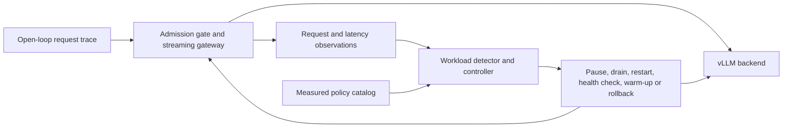

# SLO-Aware vLLM Serving Autotuner

A single-GPU serving controller for studying useful throughput under latency
service-level objectives (SLOs), and what detection, switching and safety
mechanisms cost when the workload changes.

The project runs outside vLLM. It combines measured capacity profiles, a
workload-aware controller, a streaming gateway and a transactional executor.
An independent extension studies feedback-based admission control with a fixed
backend. No model weights or vLLM scheduler kernels are modified.

[中文技术说明](docs/PROJECT_HANDOFF_ZH.md) ·
[Results](docs/RESULTS_INDEX.md) ·
[Reproduction](docs/REPRODUCIBILITY.md)

## Problem

A serving configuration that works for short prompts can miss latency targets
when longer requests arrive. Raising admission too quickly can expose more
requests to a bad decision; keeping it low wastes capacity after recovery.
On one GPU, a backend restart also interrupts service.

The offline search selects the highest measured feasible arrival rate over a
finite set of configurations and rates:

$$
\max_{\theta\in\Theta,\;\lambda\in\Lambda}\;\lambda
\quad\text{s.t.}\quad
P_{99}(\mathrm{TTFT}_c)\leq\tau_c^{\mathrm{TTFT}},\quad
P_{99}(\mathrm{E2E}_c)\leq\tau_c^{\mathrm{E2E}}
\quad\forall c.
$$

TTFT is time to first token; E2E is end-to-end latency. Here, $\theta$ is a
candidate configuration, $\lambda$ is offered requests per
second, and $c$ is a request class. Trials also have error, sample-size and
repeatability checks. This is empirical selection on a measured grid.

Online evaluation counts **goodput**: requests that succeed and satisfy both
latency thresholds, divided by the scoring duration. It also records rejected
requests, service violations, switching time and fault exposure. HTTP 200 alone
does not mean an SLO was met.

## Design



The V1 controller uses rolling workload profiles, confirmation, hysteresis and
cooldown. Compatible capacity recovery can reuse the running backend. Canary
recovery raises admission in verified stages and rolls back using fresh request
IDs when SLO violations persist. A failed backend replacement restores the
previous service or keeps admission closed.

The [online-admission extension](extensions/online_admission/README.md) keeps
the backend fixed and adjusts a token bucket with bounded additive increase and
multiplicative decrease. Proposals become effective only after acknowledgement.
Separate accounting and control ledgers retain every request while preventing
stale, late or mixed-revision evidence from driving a new action.

## Main results

Experiments used one RTX 4090D 24 GB, Ubuntu 22.04, vLLM 0.19.1 and Qwen2.5
FP16 models. V1 has 25 final 1.5B runs, 16 final 7B runs and eight successful
7B safety runs. Exploratory runs are reported separately.

| Study | Observation | Interpretation |
|---|---|---|
| 1.5B, five paired seeds | Canary vs. binary recovery: −0.549 compliant req/s; full recovery +39.80 s | Measured healthy-path cost of staged recovery |
| 7B, four paired seeds | Canary vs. binary: −0.17447 compliant req/s; full recovery +41.96 s | The same cost remains after model-specific recalibration |
| 7B, two persistent-delay traces | Fault exposure 229 → 186 and 242 → 186 requests | Whole-fault response, including later configuration fallback |
| 7B executor probes | Normal switch 71.681 s; failed-target recovery 242.069 s | Functional recovery checks, not a recovery-time SLA |
| Independent 1.5B extension, two new seeds | Goodput +19.25% / +18.95% vs. fixed 24 RPS; 978 / 986 additional service violations | More useful throughput at the cost of initial violations |

The extension recovered before the high-load phase ended, but did not satisfy
SLOs throughout that phase. Fixed 24 RPS is a conservative baseline, not the
best possible static policy. The extension has not been validated on 7B.

The full comparisons include confidence intervals, execution-order controls and
preserved failed or inconclusive attempts:

- [1.5B final comparison](docs/experiment-015.md)
- [7B final comparison](docs/experiment-017-final-review.md)
- [7B fault and executor validation](docs/experiment-018-7b-fault-validation.md)
- [Extension final results](extensions/online_admission/GUARDED_RESULTS.md)
- [Earlier inconclusive extension protocol](extensions/online_admission/HELDOUT_RESULTS.md)

## Run without a GPU

Use Python 3.12 on Linux, or Python 3.13 for native Windows CPU checks.
Windows Python 3.12 has a coarser monotonic clock and is not suitable for the
millisecond-scale HTTP test fixtures. From the repository root, create and
activate a virtual environment, then install the CPU verification dependencies:

```sh
python -m venv .venv
# Linux/macOS: source .venv/bin/activate
# Windows PowerShell: .\.venv\Scripts\Activate.ps1
python -m pip install -c environment/release-cpu-constraints.txt .
python -m unittest discover -s tests -q
python scripts/check_7b_fault_contract.py
python -m unittest discover -s extensions/online_admission -p "test_*.py" -q
python extensions/online_admission/replay.py
```

The replay prints synthetic control decisions, including a failed actuation.
These checks do not start a model or measure GPU performance. The tests use
local HTTP servers for integration checks.

For the V1 replay, use a new output path so saved evidence stays unchanged:

```sh
python scripts/replay_controller.py --output controller-demo.json
```

Real GPU reproduction and full raw-evidence audits have additional
requirements; see [REPRODUCIBILITY.md](docs/REPRODUCIBILITY.md). A public clone
includes aggregate results and small policy inputs, not the raw evidence
archives. There is currently no public archive download URL.

## Code map

| Path | Purpose |
|---|---|
| `src/slo_autotuner/controller.py` | Workload detection, policy selection, canary and rollback |
| `src/slo_autotuner/executor.py` | Admission, in-flight accounting and backend lifecycle |
| `src/slo_autotuner/gateway.py` | HTTP/SSE proxy and request observations |
| `scripts/compare_policies.py` | Shared request traces and paired policy evaluation |
| `extensions/online_admission/` | Independent feedback controller, runners and audits |
| `tests/` | V1 regression tests |
| `configs/`, `results/` | Experiment configuration, measured policies and summaries |
| `docs/` | Protocols, experiment reports and evidence boundaries |

## Limits and scope

This is an experimental single-GPU system. It does not establish production
reliability, global optimality, multi-GPU scaling or generalization across model
architectures. A boundary-aware oracle is still constrained by its policy
catalog and restart cost; it is not a universal upper bound. Static aggressive
policies can achieve higher goodput while incurring more latency violations.

V1 and the independent extension have completed their documented experiment
scopes. Further model, workload or hardware coverage would require new
experiments.

[vLLM](https://github.com/vllm-project/vllm) provides the inference engine;
[Qwen2.5](https://github.com/QwenLM/Qwen2.5) provides the evaluated models.
For distribution contents, evidence availability and the current license
status, see [PUBLICATION.md](docs/PUBLICATION.md).
