# SLO-Aware vLLM Serving Autotuner：项目原理、实验历程与运行手册

> 本文件中的公式已预渲染为本地 SVG，因此不依赖 Markdown 预览器的 LaTeX 支持。请在 [LaTeX 源文档](PROJECT_GUIDE_ZH_LATEX.md) 中编辑内容，重新生成方法见 [公式渲染说明](../tools/formula-renderer/README.md)。

> 本文是一份面向学习、技术审阅和实验复现的中文总说明。它不仅说明项目最终要做什么，也记录从云端环境建立、基准测试、实验纠错、离线策略搜索，到在线控制器和单卡安全执行器的完整演进过程。

## 1. 一句话说明这个项目

这个项目不是训练一个更大的模型，而是研究：

> 当请求速率、输入长度、输出长度和短/长请求比例不断变化时，如何让 vLLM 自动选择经过实验验证的调度配置与准入速率，在尽可能提高有效吞吐量的同时，持续满足 TTFT 和端到端尾延迟 SLO，并在切换失败或 SLO 失守时安全回滚。

它属于 **LLM inference systems / serving systems**，关注的是模型上线后的系统问题：排队、批处理、调度、尾延迟、过载控制、在线策略切换和故障恢复，而不是 SFT、LoRA 或模型能力本身。

## 2. 为什么需要这个项目

在线 LLM 服务存在一个天然冲突：

- 批量做大、并发提高，GPU 利用率和总吞吐量通常会上升；
- 但请求需要等待更久，P99 TTFT 和 P99 E2E 往往恶化；
- 短 prompt、长 prompt 和长输出使用 GPU 的方式不同；
- 一个对 256/64 请求安全的速率，不一定对 1024/64 或混合请求安全；
- 原始吞吐量继续上升，并不代表用户得到的有效服务更多。

例如本项目在 50 req/s 时，1,000 个请求都成功返回，原始吞吐量很高，但只有约 21% 同时满足 TTFT 和 E2E 约束。若只优化 QPS，系统会把“迟到的成功响应”也当作成绩；SLO-aware tuner 则把它们视为没有产生业务价值的请求。

因此，项目的核心不是寻找一个永远最好的参数，而是建立下面这条闭环：

```text
受控流量 -> 真实测量 -> 判断 SLO 可行性 -> 生成 workload-conditioned policy
    ^                                                    |
    |                                                    v
在线请求 <- 准入控制 <- 安全执行器 <- 控制器 <- 滚动工作负载与 SLO 事件
```

## 3. 问题的数学形式

### 3.1 符号

记：

- ：工作负载类型，如 balanced、prefill-heavy、decode-heavy 或 80/20 混合流量；
- ：工作负载中的请求类别；
- ：vLLM 配置；
- ：外部提供的请求速率，单位 req/s；
- ：重复实验的随机种子或实验窗口；
- ：从请求发出到第一个 token 到达的时间；
- ：从请求发出到整个响应结束的时间；
- ：类别  的延迟上限。

本项目当前搜索的配置可写成：


其中：

- ：`max_num_batched_tokens`；
- ：`max_num_seqs`；
- ：调度策略，如 FCFS 或 priority；
- ：是否启用 prefix caching；
- ：是否启用 chunked prefill 及相关设置。

### 3.2 延迟和吞吐量

对请求 ：

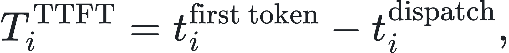


若生成  个 token，可近似定义每输出 token 时间：

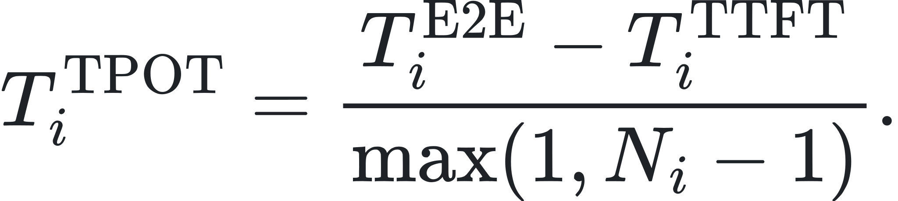

普通吞吐量只计算成功完成的请求数：


本项目更关注 goodput，即在时限内完成的有效请求：

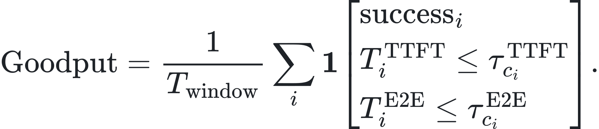

### 3.3 离线搜索：`max(...) s.t. ...`

项目目前采用的是带约束的字典序优化，而不是无方向地寻找“延迟最小”或“吞吐最大”：

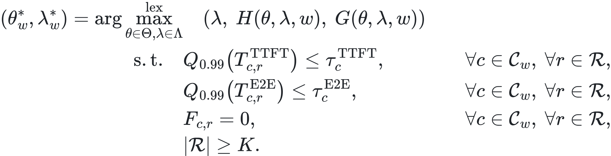

这里：

- 第一目标是最大化被重复实验支持的安全请求速率 ；
- 第二目标是最大化尾延迟余量 ；
- 第三目标才是在同等安全性下最大化 goodput ；
-  是窗口中类别  的失败数；
- 当前经验规则取 ，且要求 3/3 窗口全部通过。

混合工作负载的归一化 E2E 余量可写成：

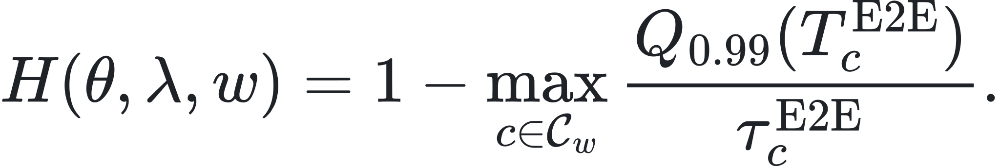

这样不会因为长请求的绝对延迟天然较大，就忽视短请求相对于自身 SLO 的恶化。

### 3.4 “经验安全”不等于“生产可靠”

候选配置  的经验安全容量定义为：

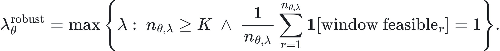

这里的 `robust` 是项目内部的证据等级，不是统计学上的高置信度承诺。即使 3/3 成功，二项分布 Wilson 95% 区间的下界也只有约 0.439。Wilson 区间为：

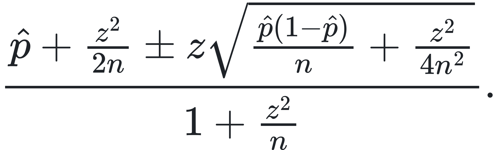

因此文档始终使用“在当前实验规则下经验安全”，而不写成“保证不会违反 SLO”。

## 4. 为什么不是盲目调参

这个项目的搜索空间和实验顺序都有系统机制指导。

### 4.1 排队理论提供方向

Poisson 开环流量的相邻到达间隔满足：

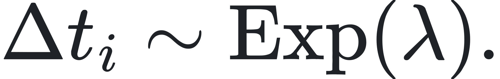

当到达率  接近服务能力  时，利用率 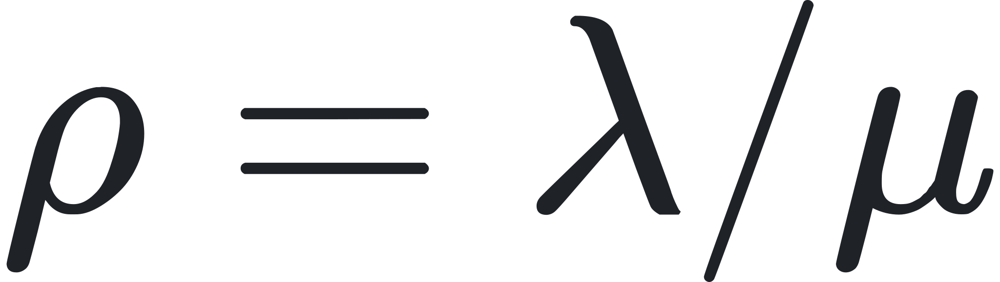 接近 1，排队时间会非线性上升。即使平均延迟看起来正常，P99 也可能先失守。因此我们围绕可行性边界重复测量，而不是在远离边界的区域浪费 GPU 时间。

### 4.2 Prefill 和 decode 不是同一种工作

- 长输入主要增加 prefill 计算，容易形成较长的一次 scheduler iteration；
- 长输出会持续占用 decode slots，但每一步的工作形态与 prefill 不同；
- `max_num_batched_tokens` 太小会切碎 prefill，太大又可能延长单轮调度并放大 head-of-line blocking；
- priority 可以重排尚未执行的请求，却不能抢占正在进行的长 prefill。

因此搜索重点放在 token budget、请求形状、调度策略和准入速率，而不是随意展开几十个无关参数。

### 4.3 Successive halving 节省实验预算

先在困难负载上低成本筛选所有候选，淘汰明显差的配置；再只给幸存者增加边界点和重复种子。这比对所有配置做完整笛卡尔积更符合云 GPU 成本约束。

## 5. SLO 如何随工作负载校准

不同长度的请求具有不同的空载延迟下限。若把 256/64 的 400 ms E2E 阈值原样套到 256/256，可能连空载请求都无法满足。项目先测每种 workload 在 concurrency=1 下的 P99 floor，再保持基准 workload 的相对余量：

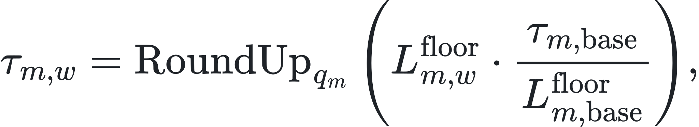

其中 ， 是固定的向上取整粒度。

得到的实验阈值为：

| Workload | 输入/输出 token | Floor P99 TTFT/E2E | 校准 SLO TTFT/E2E |
|---|---:|---:|---:|
| balanced | 256/64 | 32.81 / 288.65 ms | 100 / 400 ms |
| prefill-heavy 4x | 1024/64 | 59.01 / 314.34 ms | 180 / 440 ms |
| decode-heavy 4x | 256/256 | 36.43 / 1076.31 ms | 115 / 1500 ms |
| mixed 中的 document-long | 2048/64 | 96.30 / 353.84 ms | 295 / 500 ms |

这些是用于公平比较的实验预算，不应冒充外部公司的真实 SLA。

## 6. 总体架构

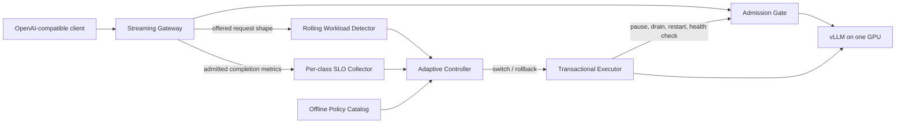

系统被刻意拆成两部分：

- **数据面**：网关、准入器和 vLLM，负责真实请求；
- **控制面**：检测器、SLO 聚合器、策略目录、状态机和执行器，负责决定与变更。

把“做决定”和“改进程”分离非常重要。控制器可以通过 deterministic replay 先验证，不必每次都真的重启 GPU 服务；只有执行器获得明确的 `switch` 或 `rollback` 决策后才产生副作用。

## 7. 在线工作负载检测

### 7.1 请求形状分类

当前设置三个 shape anchors：

- balanced：256/64；
- prefill-heavy：1024/64；
- decode-heavy：256/256。

对真实请求 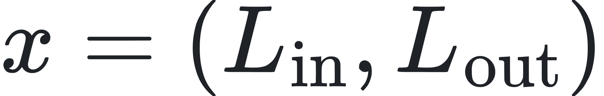 和 anchor ，使用 log-token 空间距离：

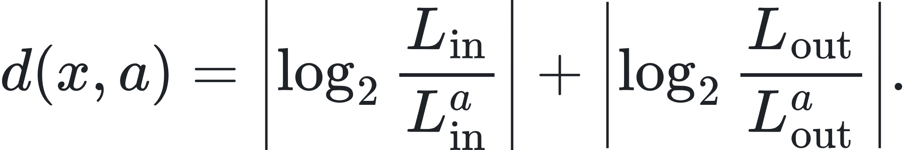

分类结果是距离最小的 anchor。使用对数而不是 token 绝对差，是因为 256→512 和 1024→2048 都表示工作量翻倍。

### 7.2 滚动分布和 Total Variation distance

在最近  秒中，shape  的经验分布为：

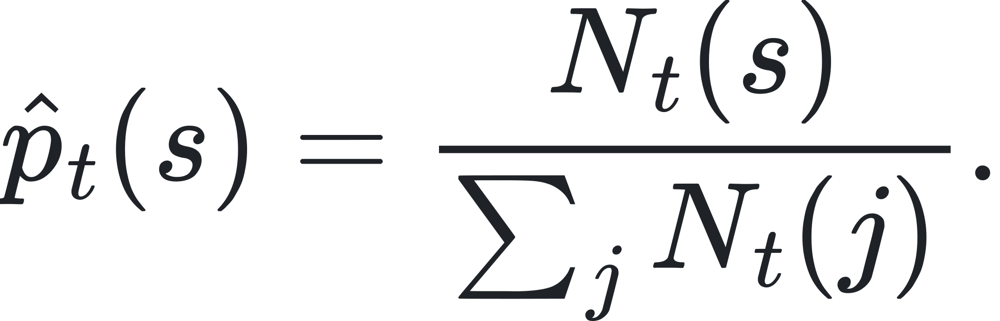

与已知 workload prototype  的距离为：

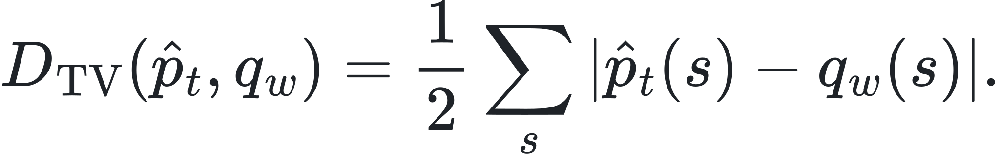

控制器不会看到一个更近的 workload 就立刻切换。候选必须同时满足：


并连续 3 个、间隔至少 10 秒的评估窗口确认。0.08 是滞回 margin，用于防止两个近似 workload 之间来回抖动；未知混合分布距离过大时，控制器选择保持，而不是硬套一个错误策略。

### 7.3 冷却与 SLO 回滚

- 普通切换后冷却 120 秒；
- 两个连续 SLO 违规窗口触发回滚；
- 回滚后的保守策略冷却 300 秒；
- SLO 安全事件优先级高于普通 cooldown，可以绕过普通冷却立即回滚；
- 若缺少某个类别或成功样本不足 5 个，状态是 `insufficient_samples`，既不算通过，也不误判失败；
- 任何已准入请求的 transport failure 都算违规，即使样本数尚少。

## 8. 准入控制与单卡安全切换

### 8.1 Token bucket

准入器使用可暂停 token bucket。设安全速率为 ，桶容量为 ，经过  后：

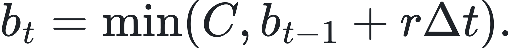

若 ，消耗一个 token 并增加 `in_flight`；否则返回 HTTP 429。切换时将 gate 设为 paused，新请求快速返回 HTTP 503，已有请求继续执行直至 `in_flight=0`。

### 8.2 切换事务

一次需要重启的正常切换具有以下不变量：

```text
admission_paused
-> in_flight_drained
-> source_stopped
-> target_start_command_succeeded
-> target_health_passed
-> target_admission_resumed
```

失败分支如下：

| 失败位置 | 系统行为 |
|---|---|
| 排空超时 | 不碰旧服务，恢复旧策略准入 |
| 旧服务停止失败，但旧服务仍健康 | 恢复控制器状态和旧准入 |
| 旧服务停止失败且不健康 | 保持 paused，避免流量进入未知状态 |
| 新策略启动或探活失败 | 停掉失败目标，重新启动旧策略并再次探活 |
| 新旧策略均失败 | 保持 paused，等待人工恢复 |
| 两策略服务端环境相同 | 只更新准入速率，不重启模型 |

这是一种 **fail closed** 设计：宁可明确拒绝请求，也不把请求送入已知不健康的后端。

## 9. Experiment 001–007：我们之前具体做了什么

### 9.1 Experiment 001：先跑通最小闭环

目标是确认单张 4090D 上，随着并发增加，何时越过 P99 SLO。

固定 256/64 token、64 个请求，扫描 concurrency 。最初结果是 concurrency=16 仍满足 100/400 ms，而 32 失败，因此离线选择器选 16。

这一阶段还观察到冷编译：第一次 concurrency=8 的 P99 TTFT 约 9.48 秒，warm-up 后降到约 81 ms。由此确定后续实验必须区分 cold start 和 steady state。

后来发现这一结果受 prefix cache 污染，因此只保留为 harness smoke test，不再宣称它是无缓存容量结论。这是项目第一次主动推翻自己的过强结论。

### 9.2 Experiment 002：改为开环 Poisson 和 goodput

闭环并发测试的问题是：服务变慢时客户端自然发得更慢，过载会被反馈机制遮住。于是改用无客户端并发上限的 Poisson arrivals，并分别统计 throughput、request compliance、goodput 和 window-level P99。

首先出现了反常结果：每轮 shell 命令中的第一个 rate 总是慢，后面的高 rate 反而更快。检查 vLLM `/metrics` 后发现：

- vLLM 0.19.1 实际启用了 prefix cache；
- 同一 seed 反复生成相同 prompt；
- 后续 rate 命中了前序实验留下的 KV cache。

修正协议为：显式关闭 prefix cache、每个测量窗口前做 64 个 warm-up、每个 rate 使用 1,000 个请求和不同 seed，并保存 Prometheus 快照。

主要结果：

| Offered rate | Goodput | P99 TTFT | P99 E2E | 窗口结论 |
|---:|---:|---:|---:|:---:|
| 20 req/s | 19.88 | 65.90 ms | 385.23 ms | pass |
| 30 req/s | 27.91 | 75.20 ms | 445.57 ms | fail |
| 40 req/s | 24.61 | 83.97 ms | 515.13 ms | fail |
| 50 req/s | 10.32 | 103.30 ms | 541.68 ms | fail |

随后用三组 seed 和 Latin-square 顺序细化 22、25、27 req/s：22 为 3/3 pass，25 为 1/3，27 为 0/3，将经验容量边界缩小到 22–25 req/s。

### 9.3 Experiment 003：有证据等级的 scheduler search

搜索 `max_num_batched_tokens` ，固定 `max_num_seqs=256`、关闭 prefix cache、启用 chunked prefill。

首次 1024/4096 筛选意外把 `max_num_seqs` 同时改成 128，形成混杂变量。我们保留原始文件作为审计记录，但从比较中排除，并修复 launcher：参数为 `auto` 时不再多发 CLI flag。

在 25 req/s 三个候选都失败；在 24 req/s，4096 失败并被 successive halving 淘汰，1024 和 2048 各补两个 seed。最终二者都是 3/3 pass：

| Token budget | 最坏 P99 E2E | Headroom | 结论 |
|---:|---:|---:|---|
| 1024 | 395.96 ms | 4.04 ms | safe survivor |
| 2048 | 392.76 ms | 7.24 ms | selected |
| 4096 | 402.26 ms | -2.26 ms | eliminated |

所以 balanced workload 选择 mbt2048，不是因为 2048 理论上永远更好，而是它在相同容量下有更保守的最坏尾延迟余量。

### 9.4 Experiment 004：workload-conditioned capacity

先用 concurrency=1 校准不同形状的 SLO，再用 mbt2048 搜索边界：

| Workload | 经验安全容量 |
|---|---:|
| 256/64 balanced | 24 req/s |
| 1024/64 prefill-heavy | 3 req/s |
| 256/256 decode-heavy | 18 req/s |

这证明一个固定全局 RPS 上限不安全，而且“总 token 数”也不足以预测容量，因为 prefill 和 decode 的调度机制不同。

prefill-heavy 下又比较了 mbt1024 与 mbt2048。4 req/s 的三组 paired deltas 符号发生变化，二者都只通过 2/3，因此不制造赢家，继续使用证据更完整的 mbt2048 作为安全 fallback。

### 9.5 Experiment 005：短长请求混合干扰

实现自定义异步流量发生器，精确分配 80% 256/64 interactive-short 和 20% 2048/64 document-long，逐请求记录 TTFT/E2E，并按类别分别判断 SLO。

原计划测试 concurrent partial prefill，但 vLLM 0.19.1 虽在 CLI help 中展示相关 flag，engine 启动时却对非默认值直接报 unsupported。没有绕过保护，而是保留失败日志，改测受支持的 priority scheduling 与较小 token budget。

Priority 确实改善了短请求 TTFT，但无法让 E2E 回到 400 ms 内；原因是 priority 可以调整等待队列，不能抢占已经执行的长 prefill。

重复边界实验还暴露了 measurement bug：某个 HTTP 200 stream 只生成被 tokenizer 跳过的特殊 token，文本为空，被旧解析器误判为失败。修复方式是强制请求 `return_token_ids=true`，用 token ID 而不是可见文本判断 first-token arrival；无效旧文件被重命名并排除，seed 44 重新运行。

最终结果：

| Candidate | 3 req/s | 4 req/s | 策略角色 |
|---|---:|---:|---|
| mbt1024 + FCFS | 3/3 pass | 1/3 pass | selected |
| mbt2048 + FCFS | 3/3 pass | 1/3 pass | rollback |

两者安全容量同为 3 req/s，1024 只凭轻微的归一化尾延迟余量胜出；文档没有夸大成显著性能优势。

### 9.6 Experiment 006：从离线表变成在线状态机

控制器直接读取前面实验生成的 `workload_policy.json` 和 `mixed_policy.json`，不手工编造容量。实现：

- log-token shape classification；
- 60 秒 rolling window；
- TV distance workload matching；
- 最少 30 样本、10 秒评估间隔；
- 三窗口确认、0.08 hysteresis；
- 120/300 秒 cooldown；
- 两次连续 SLO 失守自动 rollback。

Deterministic replay 不启动 GPU，就验证了：

```text
balanced -> mixed switch -> SLO rollback -> balanced switch
```

动作序列严格为 `switch -> rollback -> switch`。这一步把决策正确性与真实进程副作用解耦。

### 9.7 Experiment 007：接入真实事件流和执行器

实现 aiohttp streaming gateway，将真实 `/v1/completions` 请求转换成 workload observation 与 SLO event。SSE parser 能处理网络 chunk 把 UTF-8 或 JSON 切开的情况，也能识别无可见文本的 token ID。

执行器实现 pause、drain、restart、health check、startup rollback 和 fail-closed，并用 fault injection 测试所有关键失败分支。

4090D 真实验证中，控制器在 79 个滚动样本时测得：

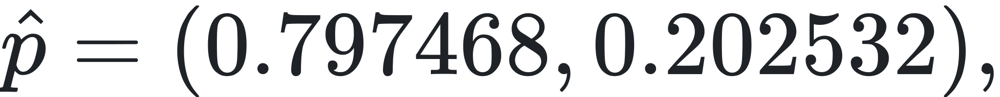


三次确认后自动执行：

```text
balanced:mbt2048-seq256
-> mixed_80_20:selected:mbt1024_fcfs
```

进程命令行最终确认为：

```text
--max-num-batched-tokens 1024
--max-num-seqs 256
--scheduling-policy fcfs
```

90 个真实网关事件中，89 个 HTTP 200；唯一的 HTTP 503 在切换暂停窗口内以 0.39 ms 返回 `admission paused`。切换后后端探活通过、准入恢复为 3 req/s，随后 5/5 smoke requests 完成。

这一轮验证的是控制面和恢复路径，不把包含计划停机的 79/80 结果当作新的性能容量结论。

## 10. 我们在云端执行过的主要操作

### 10.1 接管前先审计，而不是直接重装

每次实例重新开机后，先检查最近有效进度和当前状态：

```bash
pwd
ps -eo pid,ppid,stat,etime,args | grep -E 'vllm serve|run_gateway.py'
nvidia-smi
df -h
find results -type f | sort
bash scripts/server_ctl.sh status
bash scripts/gateway_ctl.sh status
```

目的分别是确认：项目目录、残留进程、显存占用、磁盘空间、已有结果、受管服务状态。只有确认 GPU 没有旧 worker、输出文件没有重复后，才继续下一轮。

### 10.2 建立可复现环境

实际环境固定为：

- AutoDL RTX 4090D 24 GB；
- Ubuntu 22.04；
- Python 3.12.3；
- PyTorch 2.10.0+cu128；
- vLLM 0.19.1；
- Qwen2.5-1.5B-Instruct FP16。

环境放在 `/root/autodl-tmp/envs/vllm-autotuner`，模型放在 `/root/autodl-tmp/models/Qwen2.5-1.5B-Instruct`，避免占用较小的系统盘。安装和模型下载初期网络很慢，因此切换到了云平台可用的国内下载源；换源只解决依赖/模型传输速度，不会提升推理性能。最终用 `environment/system.txt`、`environment/gpu.csv` 和 `environment/requirements.lock` 固定证据。原临时镜像地址没有写入仓库，所以本文不伪造一个无法核验的 URL。

### 10.3 启动服务并核验真实配置

核心环境变量：

```bash
export MODEL_PATH=/root/autodl-tmp/models/Qwen2.5-1.5B-Instruct
export TOKENIZER_PATH="$MODEL_PATH"
export VLLM_BIN=/root/autodl-tmp/envs/vllm-autotuner/bin/vllm
export PYTHON_BIN=/root/autodl-tmp/envs/vllm-autotuner/bin/python
```

`serve.sh` 统一生成 vLLM 命令；`server_ctl.sh` 使用 PID file 和独立日志完成 detached start/status/stop。每次修改配置后都同时检查三类证据：

```bash
curl -fsS http://127.0.0.1:8000/health
ps -eo pid,ppid,stat,etime,args | grep 'vllm serve'
tail -n 80 logs/server.log
```

仅“start 命令返回 0”不算成功；必须看到 health=200，并从实际进程命令行或 engine log 确认 token budget、sequence limit、cache 和 scheduling policy 确实生效。

### 10.4 运行基准、保存逐请求证据

闭环 smoke test 使用：

```bash
bash scripts/run_concurrency_sweep.sh
python scripts/summarize_results.py \
  --max-p99-ttft-ms 100 \
  --max-p99-e2el-ms 400
```

开环 Poisson 模板使用：

```bash
export REQUEST_RATES="22 25 27"
export NUM_PROMPTS=1000
export NUM_WARMUPS=64
export SERVER_PREFIX_CACHING=false
bash scripts/run_poisson_sweep.sh
```

每个结果 JSON 保存实验 metadata 和逐请求数组，使得后续脚本能够使用新的 SLO 重新计算 goodput，而不是盲信旧摘要。原始结果、聚合 CSV、server log 和 Prometheus snapshot 都保留；发现无效实验时重命名并从 manifest/pattern 中排除，不直接删除审计证据。

### 10.5 聚合证据并生成机器可读策略

主要分析操作为：

```bash
python scripts/aggregate_poisson.py
python scripts/evaluate_scheduler_search.py
python scripts/calibrate_workload_slos.py
python scripts/evaluate_workload_search.py
PYTHONPATH=src python scripts/evaluate_mixed_search.py
PYTHONPATH=src python scripts/replay_controller.py
```

它们完成 metadata 校验、按 candidate/rate/seed 聚合、P99 与 goodput 重算、证据等级判断和策略输出。最终控制器消费的是生成的 JSON policy，而不是把实验结论重新硬编码一遍。

### 10.6 接入真实网关并观察在线切换

```bash
bash scripts/gateway_ctl.sh start
curl -fsS http://127.0.0.1:8080/health
curl -fsS http://127.0.0.1:8080/controller/state
curl -fsS 'http://127.0.0.1:8080/events?limit=50'
```

真实切换时持续观察：

- `active_policy` 是否从 mbt2048 变为 mbt1024；
- `admission.paused` 是否在重启时变为 true；
- `in_flight` 是否先归零；
- `backend_healthy` 是否经历 false→true；
- `ExecutionResult.steps` 是否完整；
- 新进程参数和 GPU worker 是否对应目标策略；
- 日志中是否出现 traceback。

测试 suite 使用远端同一 Python 环境运行，最终 40/40 通过：

```bash
PYTHONPATH=src "$PYTHON_BIN" -m unittest discover -s tests -v
```

### 10.7 每轮结束时安全关机

停止顺序固定为“先入口、后模型”：

```bash
bash scripts/gateway_ctl.sh stop
```

该命令默认同时停止 gateway 和 vLLM。随后独立验证：

```bash
ps -eo pid,args | grep -E 'run_gateway.py|vllm serve'
curl --max-time 2 http://127.0.0.1:8000/health
curl --max-time 2 http://127.0.0.1:8080/health
nvidia-smi --query-compute-apps=pid,process_name,used_memory --format=csv,noheader
nvidia-smi --query-gpu=memory.used,memory.total,utilization.gpu --format=csv,noheader
```

最后一次收尾的结果是：gateway stopped、server stopped、8000/8080 均关闭、GPU 0 MiB / 0%。只有完成这一步后，才明确通知可以关闭 AutoDL 实例。

## 11. 代码与产物地图

| 路径 | 作用 |
|---|---|
| `src/slo_autotuner/open_loop.py` | 读取开环结果、重算 goodput 和重复实验状态 |
| `src/slo_autotuner/search.py` | scheduler candidate 聚合与选择 |
| `src/slo_autotuner/mixed.py` | 混合类定义、Poisson 计划、逐类摘要和 token 检测 |
| `src/slo_autotuner/mixed_search.py` | 混合候选的 repeated-window 评估 |
| `src/slo_autotuner/controller.py` | shape detector、TV distance、滞回、冷却和 SLO rollback |
| `src/slo_autotuner/gateway.py` | 真实 SSE 代理、事件采集、在线 control loop |
| `src/slo_autotuner/executor.py` | admission gate、drain、restart、health check、失败回滚 |
| `configs/*.json` | workload、候选、证据规则和控制器参数 |
| `results/raw/` | 逐请求 JSON、server logs、Prometheus 原始证据 |
| `results/workload_policy.json` | homogeneous workload policy catalog |
| `results/mixed_policy.json` | mixed selected/rollback policy |
| `results/controller_replay.json` | 无 GPU 状态机回放 |
| `results/live_gateway_*` | 真实切换请求、事件和状态证据 |
| `docs/experiment-001.md`–`015.md` | 每次实验的问题、结果、修正和边界 |

## 12. 当前项目已经实现了什么

目前已经完成：

1. 可复现的单卡 vLLM 环境；
2. closed-loop 与 open-loop benchmark harness；
3. TTFT、TPOT、ITL、E2E、throughput、goodput 和 P99；
4. cache/warm-up/seed/metadata 控制；
5. scheduler token-budget successive-halving search；
6. workload-conditioned SLO 与容量策略；
7. 多类别混合流量和独立 SLO；
8. 滚动 workload detector；
9. hysteresis、confirmation、cooldown 和 SLO rollback；
10. 真实 streaming gateway；
11. pause admission、drain、restart、health check 与 startup rollback；
12. 性能就绪预热、基于新请求 ID 的回滚确认与兼容策略恢复；
13. Oracle 上界、控制器组件消融与滚动检测成本分解；
14. 基于动作风险的非对称确认/滞回策略及三 seed 配对验证；
15. 二值恢复后的 SLO 自动回滚与 canary `3 → 8 → 16 → 24` 分级升容；
16. 五 seed、五策略、循环执行顺序的最终基准；
17. 77 个自动化测试及真实 4090D 的重启/免重启切换验证。

它已经不是“跑了几个 vLLM benchmark”的脚本集合，而是一个从 **measurement → evidence → policy → online decision → safe execution** 连起来的原型系统。

## 13. 当前局限与证据范围

- 单副本只要修改需要 model reload 的参数，就不可避免有短暂不可用；本次真实验证明确观测到一个 503。
- 生产系统应由客户端对 503 做 bounded retry，或使用双副本/蓝绿切换。
- 在线 rolling state 仍在内存中；JSONL 是审计日志，不是完整 crash recovery。
- 当前网关只覆盖 streaming `/v1/completions`，尚未统一支持 chat、batch 和多 prompt。
- 当前 workload prototype 数量有限，unknown distribution 只保持策略，没有在线探索。
- 三个重复窗口仍远不足以承诺生产可靠性。
- SLO 是实验校准值，不是来自真实业务合同。
- 单张 4090D + 1.5B 模型可以验证机制，但不能直接代表多机大模型 serving 的绝对性能。

这些不是项目失败，而是下一步实验问题的来源。

## 14. 控制器实验的逐步演化

> 2026-09-10 更新：静态/自适应 pilot、Oracle、控制器消融、确定性安全场景和非对称恢复的三 seed 配对实验均已完成。结果分别见 Experiment 008–011。

下一阶段不应继续随意增加参数，而应回答：“自适应真的比静态策略好吗，控制机制本身值不值得？”

### 14.1 静态策略 vs 自适应策略

设计包含 workload shift 的时间序列，对比：

- static mbt2048 + fixed admission；
- static mbt1024 + fixed admission；
- oracle：提前知道 workload；
- adaptive controller。

可比较：


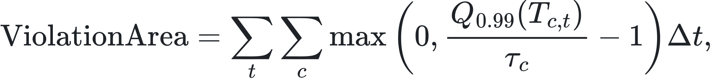

以及 503 数量、切换次数、恢复时间和 GPU 利用率。

### 14.2 控制器消融实验

分别移除 confirmation、hysteresis、cooldown 和 rollback，观察：

- 是否发生策略抖动；
- SLO violation area 是否增加；
- switch/restart 次数是否增加；
- goodput 是否真的提高。

这会证明每个控制组件不是“看起来合理”，而是有可测量贡献。

### 14.3 Recovery-time objective

进一步记录：


并将切换成本加入在线目标：

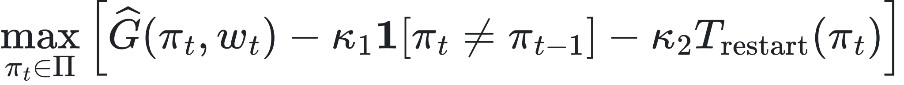

subject to per-class SLO 和 failure constraints。

需要明确：当前实现并没有在线求解上述优化问题；它使用离线生成的 policy catalog 加规则状态机。这个公式描述的是可以逐步逼近的下一版目标，而不是已经实现的能力。

## 15. 推荐学习顺序

如果你要做到“看着像自己完整做过，而且真的能讲出来”，建议按以下顺序：

1. 先理解 TTFT、E2E、P99、throughput 与 goodput 的差别；
2. 阅读 Experiment 001–002，理解为什么 open-loop、warm-up 和 cache control 决定实验有效性；
3. 阅读 `run_poisson_sweep.sh` 和一个 raw JSON，自己手算一个请求是否 compliant；
4. 阅读 Experiment 003–005，理解 candidate search、repetition、混合 class 和“不给噪声制造赢家”；
5. 手算一次 log-shape distance 和 TV distance；
6. 跟着 `controller_replay.json` 逐行解释 pending count、cooldown 和 rollback；
7. 阅读 `AdmissionGate` 和 `PolicyExecutor`，画出每个失败分支；
8. 最后阅读 live event artifact，解释为何单卡切换出现一次 503 反而证明暂停准入确实生效。

## 16. 系统技术总结

一个较准确的 40 秒版本是：

> 我做了一个基于 vLLM 的 SLO-aware serving autotuner。离线部分用 Poisson 开环流量测量逐请求 TTFT/E2E 和 goodput，在 prefix cache、warm-up、seed 与 workload shape 受控的条件下，用重复边界实验和 successive halving 生成 workload-conditioned policy。在线部分把真实 streaming request 转成滚动事件，用 log-token shape distance 和 TV distance 检测 workload shift，再通过确认、滞回和冷却抑制抖动。策略变化时，单卡执行器会暂停准入、排空请求、重启 vLLM、探活；目标启动失败则恢复最后可用策略。真实 4090D 测试完成了 mbt2048 到 mbt1024 的自动切换，并把单副本重启期间的 503 明确记录下来。

最有价值的不是某个参数数字，而是你能解释：为什么旧实验无效、如何修正、怎样避免过度结论、控制器如何稳定，以及失败时系统为何仍然安全。

## 16. 2026-09-08 更新：静态策略 vs 自适应策略的真实对照

第八轮实验在 4090D 上让三组策略复用同一条计划请求序列：60 秒短请求（16 req/s）→ 150 秒混合长请求（6 req/s）→ 120 秒短请求（16 req/s），每组 3,796 个请求。

对照包括固定 mbt2048 / 24 req/s、完整自适应控制器、固定 mbt1024 / 3 req/s。评分器按请求实际类别计算 SLO，把限流 429、重启期间的 503 和延迟超标都计入损失；每次策略切换记录开始、结束与恢复状态。

本轮最重要的发现是当前控制器的切换成本。它在 135.14 秒触发 mixed 策略切换，182.48 秒恢复服务；随后在 202.49 秒因 SLO 超标回滚，251.02 秒才再次恢复。两次重启共耗时 95.87 秒。

审计表明，触发回滚的两个窗口都只包含同一条超标请求：重启后约 0.082 秒接纳的 request_id=1732。60 秒滚动窗口每 10 秒评估一次，使这条慢请求在两次检查中重复出现；当前“连续确认”没有要求新的异常证据。其时序与冷启动瞬态一致，但具体原因还需预热 A/B 和更细的观测确认。

回滚后进入 300 秒冷却，即使请求已全部恢复为短请求，准入仍维持在 3 req/s。这说明单卡场景下，检测、冷启动、滚动统计和冷却机制需要一起评价，不能只验证每个状态机分支能否执行。

完整结果、图表、逐阶段解释和复现命令见 [第八轮实验说明](experiment-008.md)。这是单种子的 pilot：高准入静态策略虽产生更多达标请求，也违反了 P99 约束；保守策略则需要付出拒绝请求的代价。本轮不支持“某个策略永远更好”的结论。

新增代码集中在 `comparison.py`、`compare_policies.py` 和 `summarize_policy_comparison.py`。全套测试已增加到 48 项。下一轮优先检验性能预热、基于新样本的回滚确认、准入调整与重载冷却解耦，并把负载发生器拆为独立进程；这些改进尚未实现和验证。

## 17. 2026-09-09 更新：降低第二次切换成本

第九轮完成了第八轮提出的前三项修正：后端探活后先做性能预热；回滚确认必须出现新的异常 request ID；重启冷却只限制需要重载模型的配置变化，不限制兼容后端上的准入恢复。

离线证据显示 balanced 的 mbt1024 与 mbt2048 在 24 req/s 均为 3/3 次通过。评估脚本因此保留 mbt1024 作为有证据的兼容候选，而不是替换尾部余量更好的 mbt2048 主策略。真实流量回到短请求后，控制器从 mixed/mbt1024/3 req/s 切到 balanced/mbt1024/24 req/s，只用了 0.113 秒且没有重启。

在相同 seed=81、相同 3,796 请求 trace 上，改进版 adaptive 的达标请求从 1,760 增至 2,677，goodput 从 5.329 增至 8.106 req/s；503 从 1,011 降至 265，总切换时间从 92.27 降至 42.81 秒。第一次切到 mixed 仍需一次 42.70 秒的单卡重启，且总计仍有 1,098 个 429/503，因此可用性约束尚未解决。

完整实现、审计步骤、指标边界和下一轮问题见 [第九轮实验说明](experiment-009.md)。接下来优先做 oracle、控制器消融、独立负载发生器和多种子实验，而不是继续无目标地增加参数。

## 18. 2026-09-09 更新：Oracle 上界与控制器消融

第十轮在相同的 3,796 请求 trace 上比较 phase-boundary Oracle、完整控制器、四个组件消融和 minimal detector。绝对 perfect-service 上界为：


Oracle 仍支付真实单卡重启和保守准入，只达到 9.683 req/s。它的未达标请求可以完整分解：


完整控制器为 8.112 req/s，比 Oracle 少 519 个达标请求。进入 mixed 和恢复 balanced 分别延迟 75.27 秒、58.04 秒。移除 confirmation 后变为 55.24/40.16 秒；移除距离滞回门后变为 75.24/43.13 秒；组合移除保护的 minimal detector 仍需 55.25/30.16 秒。

因此检测延迟不是一个可简单相加的常数，但可以写成相互作用的组成：


在本 trace 上，60 秒滚动窗口贡献最大的剩余惯性；confirmation 额外约 20/18 秒；距离门主要影响回程约 15 秒。cooldown 和 rollback 在完整组中的分支触发次数均为 0，所以其控制路径因果成本为 0，独立运行间的小幅性能差不能归因于它们。

这轮支持非对称控制方向：进入风险 workload 保留保护，恢复已知兼容高容量策略采用更快确认。完整表格、统计陷阱与证据边界见 [第十轮实验说明](experiment-010.md)。

### 14.4 风险非对称恢复

第十一轮把切换动作按故障半径分为两类。需要修改 vLLM 启动参数的切换继续使用三次确认和 0.08 距离边际；服务器配置相同、只提高准入上限的恢复使用一次确认和零边际：

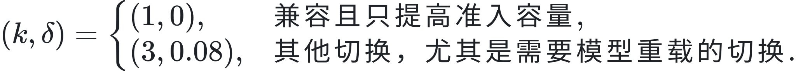

五个确定性场景分别让 confirmation、hysteresis、cooldown、rollback 和 compatible recovery 的控制分支真实触发。前三种保护分别避免约 45.06 秒、45.06 秒和 90.12 秒的重启停机代理；回滚主动支付一次重启，以离开持续违约策略。

在 RTX 4090 D 上，seed 82–84 的新旧控制器对每个 seed 复用相同开放环轨迹。非对称控制器平均提前 28.15 秒恢复高准入，整体 goodput 增加 1.075 req/s（约 13.3%），SLO 合规请求增加 355，HTTP 429 减少 368.3，且没有增加模型重启。收益集中于 balanced return 阶段；进入 mixed 的检测延迟基本不变，证明高风险方向的保护没有被放松。

HTTP 503 平均增加 14.7 个，但主要位于两组共同的 mixed 重启阶段，而且实验固定先运行新控制器，重启耗时与顺序/缓存混杂，不能归因于 210 秒后的兼容恢复。完整配对差值、局限与复现产物见 [第十一轮实验说明](experiment-011.md)。

### 14.5 顺序对照与重复切换稳定性

第十二轮不再修改控制器参数，而是检验第十一轮的两个证据缺口。首先精确复用 seed 82 请求轨迹，只把运行顺序从 `asymmetric -> legacy` 反转为 `legacy -> asymmetric`。反转后非对称控制器仍增加 1.469 req/s goodput、增加 485 个合规请求并减少 451 个 HTTP 429；两组都只重启一次。它说明收益不是固定运行顺序这一简单因素制造的，但一次反转仍不能完全分离缓存和机器时间漂移。

其次，seed 85 的 570 秒轨迹执行 `balanced -> mixed -> balanced -> mixed -> balanced` 两轮变化。整体结果为：


非对称控制器增加 740 个合规请求、减少 746 个 HTTP 429，重启次数仍为 1。首次进入 mixed 需要完整重启；之后三次切换复用已经启动的 `mbt1024` 后端，只更新准入。两次返回 balanced 分别提前 27.99 秒和 27.75 秒；第二次进入 mixed 会降低准入容量，因此仍走强确认路径，没有错误地享受快速恢复。每个真实边界恰好发生一次目标切换，无额外抖动或控制错误。

这轮把控制器设计的边界表达得更清楚：


完整顺序表、阶段时间线、证据校验与局限见 [第十二轮实验说明](experiment-012.md)。

### 14.6 快速升容后的 SLO 安全回滚

第十三轮主动攻击快速恢复的失败路径。旧实现从 mixed 快速恢复到 balanced 后，balanced bundle 没有 distinct rollback policy；即使两次新鲜 SLO 违规被确认，控制器也只能 `alert`，继续停留在 24 req/s。

新实现把快速升容改为可逆事务。令  为升容前策略、 为恢复策略：


控制器记录最后安全策略；两个包含不同新违规请求 ID 的窗口触发 admission-only rollback；回退后阻断立即再次升容；若回滚排空失败，则保留安全目标供后续重试。

确定性反事实中，启用组决策为 `switch → hold → rollback → hold`，最终从 24 降回 3 req/s；禁用组为 `switch → hold → alert → hold`，仍停在 24。真实 HTTP/SSE 故障注入进一步让慢响应经过网关、SLO collector 和 executor：启用组执行 `switch + rollback`，禁用组只有 `switch`，两组都没有调用 vLLM stop/start。完整测试增至 62 项并全部通过。

这里的慢后端是可控故障注入，不是 GPU 性能结论。它证明的是安全闭环和反事实因果作用。完整事件证据、公式与实现边界见 [第十三轮实验说明](experiment-013.md)。

### 14.7 Canary 分级升容与故障半径

第十四轮继续处理第十三轮留下的二值恢复风险。兼容恢复不再从 3 req/s 一步跳到 24 req/s，而是经过：


每次晋级需要两个 SLO-pass 窗口，而且每个窗口必须含有此前未使用过的成功请求 ID。重叠窗口重复观察同一请求时不记新票；出现待确认 workload shift 时暂停晋级；两个带新违规 ID 的 SLO-violation 窗口则退回上一个已验证阶段。四个阶段共享 vLLM server environment，因此全部切换只更新准入，不重新加载模型。

真实 HTTP/SSE 慢后端反事实中，binary 路径在回滚前暴露 48 个慢请求，canary 路径暴露 16 个：

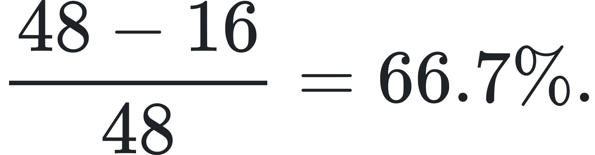

这衡量的是受控误判下的故障半径，不是 GPU 发生故障的概率。健康路径的代价由 RTX 4090 D 配对实验单独测量。seed 86–87 各自复用相同开放环轨迹并反转 binary/canary 运行顺序；canary 相对 binary 平均减少 0.580 req/s 整体 goodput、减少 191.5 个 SLO 合规请求、多 188.5 个 HTTP 429，并让 24 req/s 满容量平均晚 40.923 秒。两组每次都只因进入 mixed 重启一次，canary 没有增加模型重载。

因此本轮给出的不是“canary 免费更优”，而是一条可量化的风险—性能边界：支付约 40.9 秒分级验证时间，换取故障注入中 66.7% 的首轮暴露缩减。两个 paired seeds 仍是 trade-off pilot；阶段值与 pass 次数未来可以由风险预算或置信界决定。完整公式、逐 seed 表格、实现缺口和复现产物见 [第十四轮实验说明](experiment-014.md)。

### 14.8 五 seed 最终基准

第十五轮冻结第十四轮设计，用 seed 88–92 执行 `static aggressive`、`binary recovery`、`canary recovery`、`oracle boundary` 和 `static conservative` 五种模式。五个 seed 使用循环顺序，使每种模式恰好出现在第 1–5 个执行位置各一次；同 seed 的所有模式复用完全相同的 request schedule 和 payload hash。

25/25 个结果均完整，request/payload identity、run key 和执行顺序校验通过，control error 与 backend/transport error 均为 0。聚合 SLO goodput 为：

| 模式 | 平均 SLO goodput | seed 间样本标准差 |
|---|---:|---:|
| Static aggressive | 11.234 req/s | 0.228 |
| Oracle boundary | 9.581 req/s | 0.160 |
| Binary recovery | 9.227 req/s | 0.270 |
| Canary recovery | 8.679 req/s | 0.358 |
| Static conservative | 2.989 req/s | 0.007 |

Static aggressive 虽然没有 HTTP 429/503，平均仍有 70.2 个 completed-but-late 请求和最高的 tail-violation area；static conservative 的 tail area 为零，却平均拒绝 2793 个请求。两者分别是吞吐/风险极端与过度保护极端，不能只看 `paused=False` 或 HTTP 200 判断 SLO。

对五个 seed 的 canary-minus-binary 差值使用自由度 4 的双侧 Student-t 区间：


tail-area 差为 −0.328，95% 区间 [−1.871, 1.216]，不能声称 canary 改善健康路径尾延迟。稳定结论是：canary 以约 0.55 req/s goodput 和约 40 秒满容量恢复时间，换取受控故障注入中 66.7% 的暴露缩减。完整逐 seed 结果、统计方法和证据边界见 [第十五轮实验说明](experiment-015.md)。

## 15. 下一阶段：模型规模泛化

主实验已经从机制实现推进到五 seed 最终评估。下一阶段不再调整 1.5B 参数，而是按预注册协议检验 Qwen2.5-1.5B → 7B 的模型规模泛化：

1. 在 1 req/s 下用三个 calibration seed 测量 7B 的 short/long 低负载 P99；
2. 在看到容量结果前冻结模型专属 SLO；
3. 对 1024/2048 token-budget 候选搜索 balanced 与 mixed 稳健容量；
4. 依据容量区间派生 canary 阶段，不复用 1.5B 的绝对 `8/16/24`；
5. 使用未参与选择的 final seed 做 binary、canary、oracle 与 static 对照。

该阶段只支持“同系列跨参数规模泛化”，不宣称跨模型架构泛化。预注册公式和停止规则见 [Experiment 017 预注册](experiment-017-preregistered.md)。
