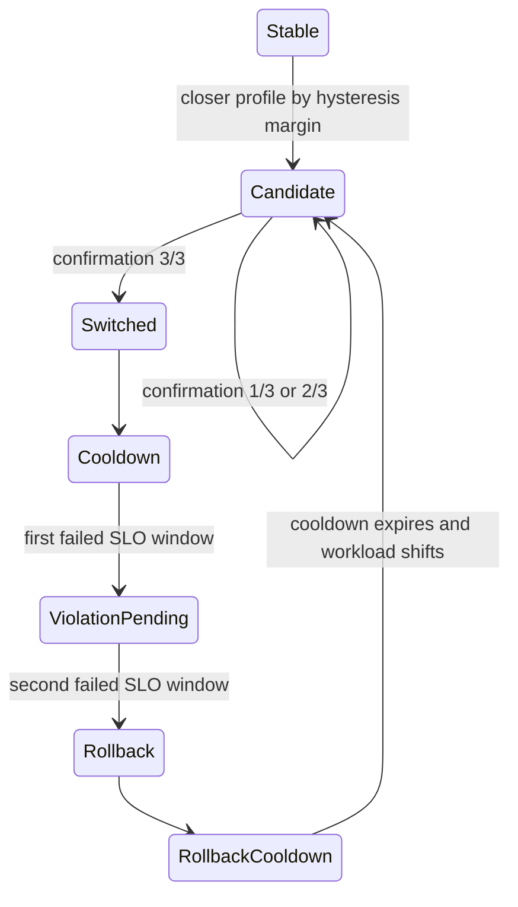

# Experiment 006: adaptive controller state machine

## Objective

Turn the measured workload policies into a control plane that can detect a
workload shift, select the matching policy, suppress oscillation, and roll back
when post-switch SLO windows fail.

The controller is intentionally separate from vLLM process management. It
emits a complete execution decision—including admission limit, server
environment and whether a restart is required—so a later deployment adapter
can perform drain, restart and health checks without embedding those side
effects in the decision logic.

## Inputs and policies

The policy catalog is built directly from `workload_policy.json`,
`mixed_policy.json` and the workload SLO manifest. No capacity is invented by
the controller.

| Detected profile | Primary policy | Admission limit | Rollback |
|---|---|---:|---|
| balanced | mbt2048, FCFS | 24 req/s | none yet |
| prefill-heavy | mbt2048, FCFS | 3 req/s | none yet |
| decode-heavy | mbt2048, FCFS | 18 req/s | none yet |
| 80/20 short/document | mbt1024, FCFS | 3 req/s | mbt2048, FCFS at 3 req/s |

Each incoming request is mapped to the nearest balanced, prefill-heavy or
decode-heavy shape anchor using distance in log2 token-length space. The
rolling class distribution is then compared with known workload prototypes
using total-variation distance.

## Stability controls

The checked-in controller configuration uses:

| Control | Value | Purpose |
|---|---:|---|
| rolling window | 60 s | forget stale workload history |
| minimum samples | 30 | avoid decisions from sparse traffic |
| evaluation interval | 10 s | avoid counting the same snapshot too rapidly |
| switch confirmation | 3 windows | require persistence before switching |
| distance improvement margin | 0.08 | hysteresis against near-ties |
| maximum profile distance | 0.20 | reject unknown mixtures |
| normal cooldown | 120 s | prevent switch thrashing |
| rollback confirmation | 2 SLO windows | reject one noisy tail window |
| rollback cooldown | 300 s | keep the conservative policy after failure |

Normal profile changes respect cooldown. Confirmed SLO failure is a safety
event and bypasses normal cooldown.



## SLO guard

SLO input is a per-class window containing completed and failed request counts,
P99 TTFT and P99 E2E. A missing class or fewer than five samples is marked
`insufficient_samples`; it is neither silently passed nor counted as a
violation. Any transport failure or tail-latency breach contributes a concrete
reason to the decision record.

For the mixed profile, two consecutive short-class P99 E2E breaches switch the
active policy from mbt1024 to the empirically safe mbt2048 rollback. If a
profile has no distinct rollback candidate, the controller emits `alert`
instead of pretending it performed a recovery.

## Deterministic replay

`replay_controller.py` executes this scenario without a GPU:

1. stable balanced traffic;
2. an exact 80/20 short/document shift;
3. three confirmed detector windows and a switch to mixed mbt1024;
4. one passing SLO window;
5. two consecutive short-class P99 E2E violations;
6. rollback to mixed mbt2048 despite the active normal cooldown;
7. a balanced shift after rollback cooldown and three-window confirmation.

The observed action sequence is:

```text
switch -> rollback -> switch
```

The final switch from mixed rollback to balanced changes only the admission
limit because both policies use the same vLLM environment. The earlier mixed
switch and rollback change the token budget, so their decisions correctly set
`requires_server_restart=true`.

## Verification and remaining boundary

The complete repository now has 27 passing unit tests, including tests for
shape detection, hysteresis, switch confirmation, cooldown blocking,
insufficient SLO evidence, rollback during cooldown, policy loading and the
previous benchmark/search behavior.

The state machine and action contract are implemented. The next deployment
step is a single-GPU executor that pauses admission, drains in-flight requests,
restarts vLLM when required, health-checks the new process, and feeds live
request/SLO events into this controller. That operational step should be tested
with a canary before enabling automatic process mutation.
