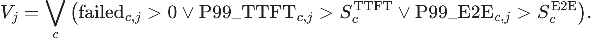
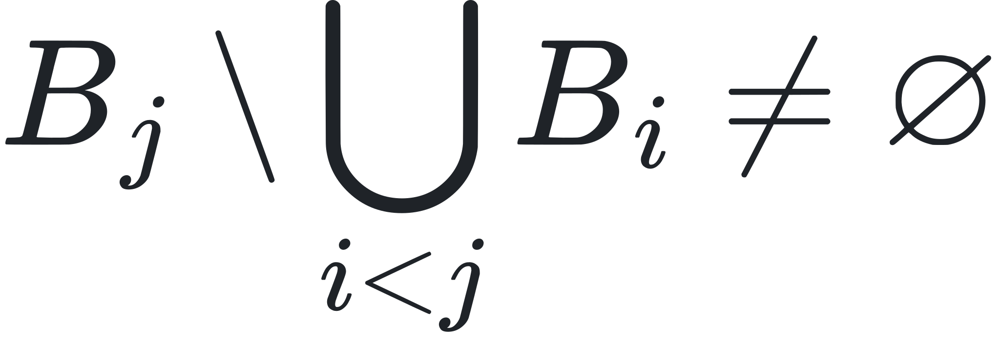

# Experiment 013：快速升容后的 SLO 失守回滚

> 本文件中的公式已预渲染为本地 SVG，因此不依赖 Markdown 预览器的 LaTeX 支持。请在 [LaTeX 源文档](experiment-013_LATEX.md) 中编辑内容，重新生成方法见 [公式渲染说明](../tools/formula-renderer/README.md)。

## 1. 研究问题

实验 011–012 证明，服务器配置兼容且只提高准入容量时，可以跳过模型重启并快速恢复 goodput。但这种优化有一个必须正面回答的安全问题：

> 如果检测器把 workload 判断为 balanced，并把准入从 3 req/s 提高到 24 req/s，随后真实延迟却违反 SLO，控制器能否自动退回最后安全策略？

代码审查发现旧实现存在明确缺口。快速恢复后活动画像变成 `balanced`，而 balanced policy bundle 没有独立 rollback policy。因此连续 SLO 失守只能产生 `alert`，不能恢复原先的保守准入；同时兼容恢复可以绕过模型重启冷却，简单回退后还可能马上再次升容。

本轮先构造反例，再实现闭环，并通过启用/禁用新保护的反事实实验验证因果作用。

## 2. 安全目标

设快速恢复前的最后安全策略为 ，兼容高容量策略为 ，其准入容量满足：


其中  表示 vLLM 服务器环境。环境相同意味着回退只需更新网关准入，不需要停止或重新加载模型。

第  个 SLO 窗口的违规条件为：



为避免重叠窗口反复利用同一个慢请求，本轮延续“新鲜证据”约束。令  为窗口  的违规请求 ID 集合，则只有



才把该窗口计入连续违规确认。当两次含新证据的违规窗口被确认时：


回滚后设置容量上调阻断区间 ，避免下一次检测 tick 立即重新升容：


## 3. 实现

控制器新增三类状态：

- `recovery_rollback_policy_name`：快速升容前的最后安全策略；
- `recovery_rollback_profile`：与该策略一致的 workload 画像；
- `capacity_increase_block_until_s`：SLO 回滚或执行失败后禁止再次升容的截止时间。

执行流程为：

1. 仅当切换兼容且准入容量增加时，记录来源策略作为恢复点；
2. 快速恢复后的 SLO pass 不影响正常服务，违规窗口必须包含新的违规请求 ID；
3. 两次新鲜违规窗口触发 `rollback`；
4. 若回退策略与当前策略服务器环境相同，只暂停准入、排空并恢复较低准入，不操作 vLLM 生命周期；
5. 回退后使用 `rollback_cooldown_seconds` 阻止立即重新升容；
6. 如果回滚事务自身排空超时，恢复当前服务，但保留回滚目标供后续新证据重试。

配置开关 `compatible_recovery_rollback_enabled` 允许构造禁用保护的反事实对照，默认项目配置已启用。

## 4. 确定性反事实

`run_recovery_fault_scenarios.py` 固定检测器输出 balanced，并向控制器提供两个包含新违规请求的窗口。

| 模式 | 决策序列 | 最终准入 | 最终策略 | 重启 |
|---|---|---:|---|---:|
| 启用保护 | switch → hold → rollback → hold | **3 req/s** | mixed safe point | 0 |
| 禁用保护 | switch → hold → alert → hold | **24 req/s** | balanced high capacity | 0 |

最后一个 hold 的含义不同：启用组由容量上调冷却主动阻止立刻重试；禁用组只是因为检测画像与当前 balanced 一致，根本没有完成补救。

## 5. 真实网关事件流故障注入

确定性状态机测试仍可能绕过事件采集链，因此第二层实验让请求真正经过：

```text
HTTP client → token-bucket admission → gateway → SSE backend
            → TTFT/E2E collector → controller → executor
```

后端是可控的本地 aiohttp SSE 服务：约 120 ms 后发送首 token，约 440 ms 后结束。balanced SLO 为 TTFT 100 ms、E2E 400 ms，因此这是人为构造、可复现的慢后端故障，不是 RTX 4090 D 的性能测量。

每种模式共向网关发送 64 个真实 HTTP 请求：

- 40 个请求建立 balanced 检测证据；初始准入 3 req/s，因此 1 个成功、39 个 429；
- 快速升容到 24 req/s 后发送两批各 12 个请求；每批 6 个成功、6 个 429；
- 成功请求的实测 P99 超过 100/400 ms 阈值，并且第二批提供新的违规请求 ID。

## 6. 事件流结果

| 指标 | 启用保护 | 禁用保护 |
|---|---:|---:|
| 网关事件数 | 64 | 64 |
| 决策记录数 | 7 | 7 |
| 执行事务 | switch + rollback | switch |
| 最终准入 | **3 req/s** | **24 req/s** |
| 最终活动策略 | mixed safe point | balanced high capacity |
| vLLM 生命周期调用 | 0 | 0 |
| 控制错误 | 0 | 0 |

启用组触发回滚时记录的实测窗口为：P99 TTFT 129.16 ms、P99 E2E 450.65 ms。禁用组在 P99 TTFT 131.46 ms、P99 E2E 452.48 ms 时只发出 `alert`。两组请求路径和故障类型相同，差别来自回滚保护开关。

因此得到反事实因果链：


## 7. 测试与回归保护

新增测试覆盖：

- 快速恢复后两次新鲜 SLO 违规触发跨画像、同服务器环境回滚；
- 禁用保护可复现旧版“只能 alert”的缺口；
- executor 将准入从 24 降至 3，且不调用 stop/start/health/warm-up；
- 回滚排空超时后仍保留安全目标，允许后续重试；
- 原有“兼容恢复可绕过模型重启冷却”的正常路径没有被误伤。

云端完整测试由 58 项增加到 62 项，全部通过。

## 8. 结论与边界

本轮把快速恢复从单纯的性能优化补成了可逆事务：控制器不仅知道“升到哪里”，还记得“出问题退回哪里”，并能避免刚回退就再次升容。整个补救只改变网关准入，不重新加载模型。

证据边界如下：

- 确定性反事实证明控制分支的因果作用；
- HTTP/SSE 故障注入证明真实请求测量、SLO collector、控制器和 executor 已连通；
- 模拟慢后端不代表真实 GPU 上该故障发生的概率，也不用于宣称 goodput 提升；
- 回退到 3 req/s 是保守安全点，会牺牲吞吐。长期方案应增加分级降容或 canary ramp，而不是永远在 3 与 24 之间二值跳转。

## 9. 主要运行操作与产物

本阶段执行了：

1. 审查快速恢复后的 rollback policy、SLO collector 和 executor 失败路径；
2. 找到 balanced 快速恢复后只能告警、不能回滚的反例；
3. 在云端改动前创建 `run/pre013-code-backup.tar.gz`；
4. 实现最后安全点、容量上调阻断和回滚失败重试状态；
5. 首次回归测试发现阻断条件作用域过宽，收窄到 SLO 回滚或执行失败之后；
6. 按 `PYTHONPATH=src` 运行 62 项测试并全部通过；
7. 运行确定性启用/禁用反事实；
8. 运行真实 HTTP/SSE 事件流慢后端故障注入；
9. 将完整决策、执行事务和请求事件证据同步回本地。

关键产物：

- `src/slo_autotuner/controller.py`
- `src/slo_autotuner/executor.py`
- `configs/controller.json`
- `scripts/run_recovery_fault_scenarios.py`
- `scripts/run_live_recovery_fault_scenario.py`
- `results/recovery_fault_scenarios.json`
- `results/live_recovery_fault_scenario.json`
- `tests/test_controller.py`
- `tests/test_executor.py`
