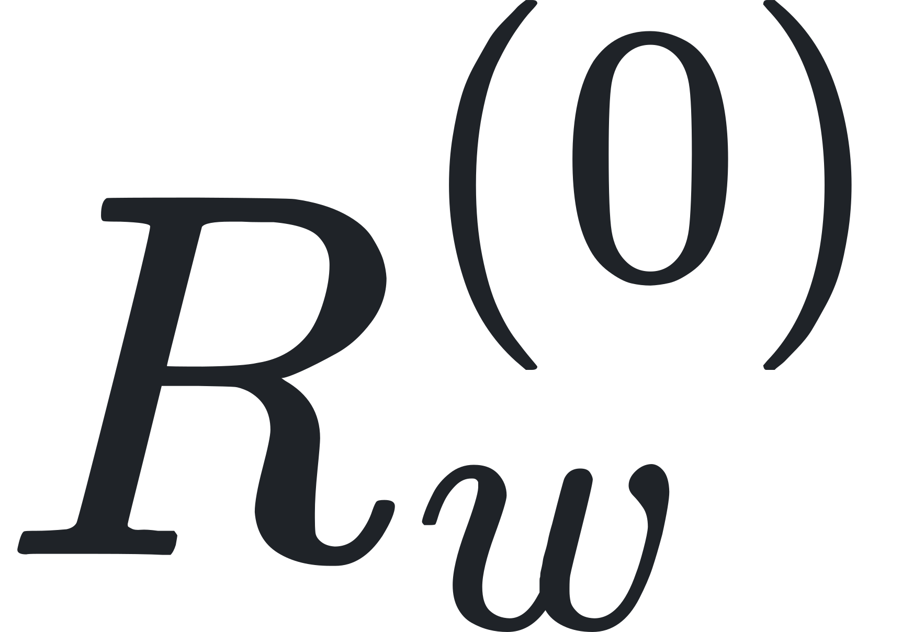
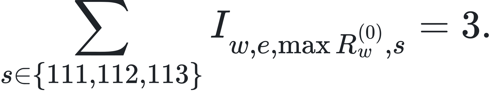
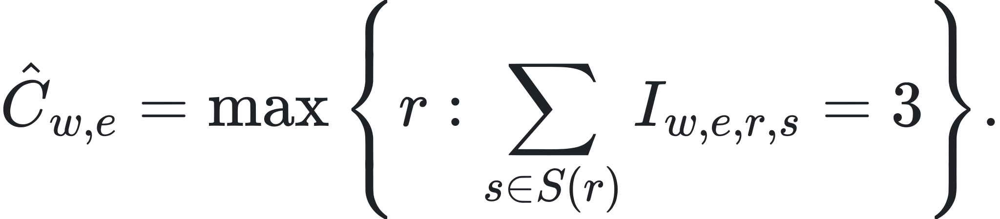
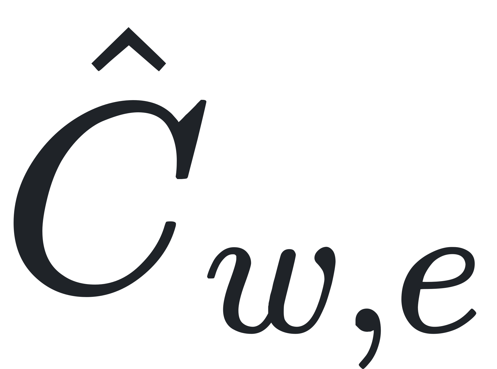

# Experiment 017：容量搜索右删失修正（预注册补充）

> 本文件中的公式已预渲染为本地 SVG，因此不依赖 Markdown 预览器的 LaTeX 支持。请在 [LaTeX 源文档](experiment-017-capacity-extension_LATEX.md) 中编辑内容，重新生成方法见 [公式渲染说明](../tools/formula-renderer/README.md)。

## 为什么需要补充搜索

基础容量搜索只测到 balanced 负载的 12 req/s。若候选环境在 12 req/s 的三个 seed 全部通过，则观测只支持下界

而不支持把容量写成 。这里的 12 是搜索网格的上界，不是一次已经观测到的 SLO 失守边界；这种情况记为右删失（right-censored）。

## 触发规则

令基础网格为 ，每个速率运行三个 seed。候选  进入扩展搜索，当且仅当

这条规则仅使用基础实验结果。扩展的 seed 和速率在读取任何扩展结果前冻结。

## 冻结的扩展协议

- 新 seed：114、115、116，与 SLO 校准 seed（101–103）、基础容量 seed（111–113）和最终评估 seed（121–124）完全分离。
- balanced 扩展网格：14、16、18、20、24 req/s。
- mixed 扩展网格：5、6、8、10 req/s。
- 只对基础网格右删失的候选执行扩展；已有失败边界的候选不重复消耗 GPU。
- 每个扩展速率仍要求 3/3 seed 同时满足全部类别 SLO。
- 某候选在第一个未达到 3/3 的速率处停止，不再运行更高速率。

扩展后的稳健容量仍定义为

其中基础速率使用 ，扩展速率使用 。只有在  上方实际观测到一个不满足 3/3 的速率，容量才标记为 `bounded_by_observed_failure`；若扩展网格最高点仍通过，则继续诚实报告下界，不进入最终 benchmark。

## 防止结果泄漏

分析器按 manifest 中声明的 seed 过滤原始文件。重新计算基础策略时只能读取 111–113；扩展后的最终容量策略才允许读取 111–116。由此即使任务中断后恢复，已有扩展文件也不会反向改变“为什么触发扩展”的决定。
